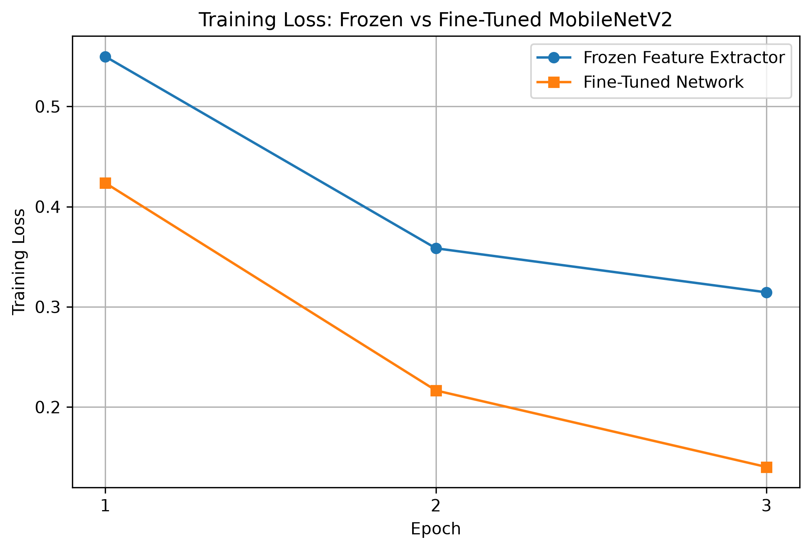

# CS5720-Home-Assignment-3

**Course:** CS5720 — Neural Networks and Deep Learning  
**Student Name:** Moulika Reddy Karra
**University:** University of Central Missouri  
**Programming Language:** Python 3.12  
**Frameworks/Libraries:** TensorFlow, Keras, NumPy, Matplotlib

## Part II — Question 1: Convolution from Scratch

### Objective

The objective of this task is to implement a 2D convolution operation using Python and NumPy without using built-in convolution functions.

### Implementation

I used a 5×5 input matrix and a 3×3 filter with stride 1 and padding 0. The program slides the filter over the input matrix and performs element-wise multiplication followed by summation to calculate each value in the output feature map.

**Output Feature Map:**

```text
[[4 3 4]
 [2 4 3]
 [2 3 4]]
```

**Output Shape:** (3, 3)

### Effect of Changing Stride

When the stride changes from 1 to 2, the filter moves two positions instead of one. This reduces the output feature map size from 3×3 to 2×2.

**Python File:** `task1_convolution_from_scratch.py`

## Part II — Question 2: Transfer Learning — Freeze vs. Fine-Tune

### Objective

The objective of this task is to compare frozen feature extraction and fine-tuning using a pretrained convolutional neural network.

### Dataset and Model

- **Dataset:** CIFAR-10 (Cats and Dogs)
- **Pretrained Model:** MobileNetV2 with ImageNet weights
- **Training Images:** 2,000
- **Validation Images:** 500
- **Testing Images:** 500
- **Image Size:** 96×96
- **Epochs:** 3

### Experiment A: Frozen Feature Extraction

In this experiment, I froze all the pretrained MobileNetV2 layers and trained only the newly added classification layer.

### Experiment B: Fine-Tuning

In this experiment, I unfroze the last convolutional block of MobileNetV2 and trained it along with the new classification layer. The Batch Normalization layers remained frozen.

### Results Comparison

| Method | Trainable Parameters | Training Time | Test Accuracy |
|---|---:|---:|---:|
| Frozen Feature Extractor | 1,281 | 13.39 seconds | 84.60% |
| Fine-Tuned Network | 880,321 | 14.18 seconds | 83.00% |

### Training Loss Comparison



### Discussion

In this experiment, I compared frozen feature extraction and fine-tuning using the pretrained MobileNetV2 model on the CIFAR-10 cats and dogs dataset. The frozen feature extractor had 1,281 trainable parameters and achieved 84.6% test accuracy in 13.39 seconds. The fine-tuned model had 880,321 trainable parameters and achieved 83.0% test accuracy in 14.18 seconds. The fine-tuned model achieved a lower training loss because its final convolutional block was allowed to update its weights during training. However, its test accuracy was slightly lower than the frozen model, which may indicate some overfitting. The frozen feature extractor required fewer trainable parameters and slightly less training time while achieving better test accuracy in this experiment. Overall, the results show that fine-tuning does not always improve test accuracy, especially when the training dataset is small.

## How to Run the Programs

Activate the Conda environment:

```bash
conda activate cs5720
```

Run Question 1:

```bash
python task1_convolution_from_scratch.py
```

Run Question 2:

```bash
python task2_transfer_learning.py
```

The second program trains both models, prints the comparison results, and saves the training-loss graph.

## Files

- `task1_convolution_from_scratch.py` — Convolution implementation
- `task2_transfer_learning.py` — Frozen feature extraction and fine-tuning
- `task2_training_loss.png` — Training-loss comparison graph
- `README.md` — Assignment documentation
